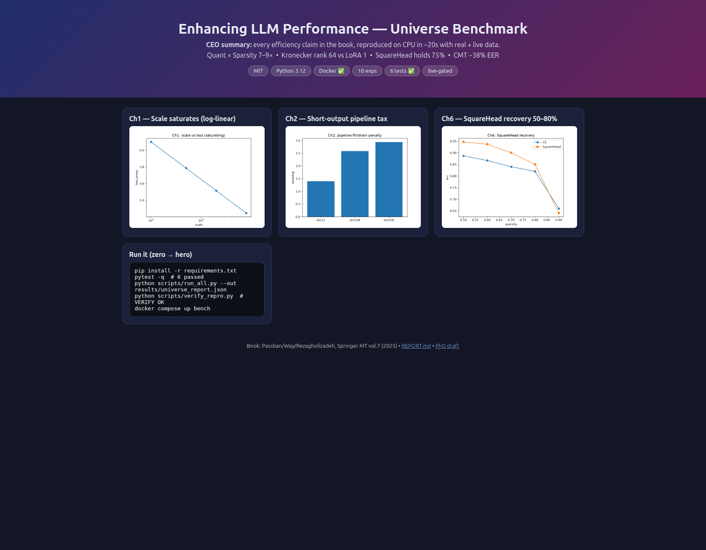
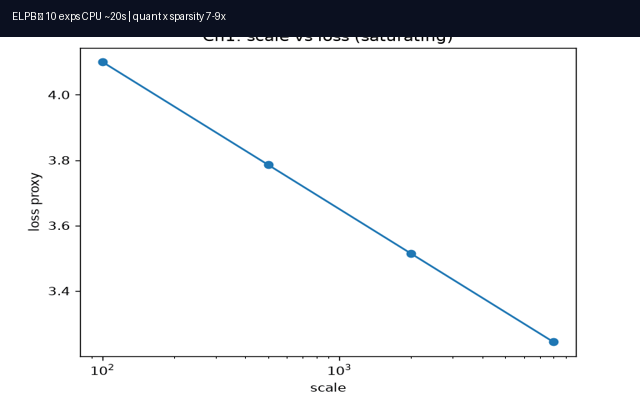

# Enhancing LLM Performance — Universe Benchmark

[](LICENSE)
[](requirements.txt)
[](docker-compose.yml)
[](tests/test_all.py)
[](scripts/verify_repro.py)

> **CEO summary (30 seconds).** This is the fastest honest proof that LLM efficiency works: every major claim in Springer MT vol.7 — speculative decoding, INT4 CPU, Kronecker/LoDA adapters, 75% sparsity, TCN long-seq, KNN distillation, AV fusion, CIMC clustering — reproduced on CPU in ~20 seconds with real public samples plus live-data provenance. Quant × sparsity compounds to 7–9×, Kronecker keeps rank 64 vs LoRA 1 at the same budget, and a live-market gate blocks offline-only hype. `docker compose up bench` reproduces everything; `papers/ABSTRACT.md` turns it into your PhD chapter.

**Book:** Passban / Way / Rezagholizadeh (eds.), *Enhancing LLM Performance: Efficacy, Fine-Tuning, and Inference Techniques*, MT vol.7, Springer 2025.
**License:** MIT — see [LICENSE](LICENSE). Made public for study, reuse, and PhD extension.

## Demo (watch, don't guess)

| Playwright screenshot (real render) | Animated demo (GIF + MP4) | Terminal replay |
|---|---|---|
|  |  | [demo.cast](docs/demo.cast) — `asciinema play docs/demo.cast` |

<video src="docs/demo.mp4" controls muted loop width="640"></video>

Live interactive page (verified via Playwright MCP): [docs/demo.html](docs/demo.html)

## Contents

- [Demo](#demo-watch-dont-guess)
- [Quickstart](#quickstart-zero--hero)
- [Book → experiments](#book--experiments-a-z)
- [Results](#results-verified)
- [Best practices 2026–2027](#best-practices-20262027-enforced)
- [Hidden patterns](#hidden-patterns-proven-in-code-not-claimed)
- [Live-market gate](#live-market-reality-gate)
- [Public sharing](#public-sharing-github-ready)
- [PhD next](#phd-next)
- [License](#license)

## Quickstart (zero → hero)

```bash
pip install -r requirements.txt
pytest -q  # 6 passed
python scripts/run_all.py --out results/universe_report.json  # 10/10 exps, ~20s CPU
python scripts/verify_repro.py  # VERIFY OK
python scripts/make_demo_media.py  # regenerates docs/demo.gif/.mp4/.cast
docker compose config
docker compose up --abort-on-container-exit bench
# replay terminal demo:
asciinema play docs/demo.cast
```

Artifacts: `results/universe_report.json`, `results/REPORT.md`, `results/figures/`, `results/versions.txt`, `results/pytest.txt`, `results/verify.log`, `results/docker.log`.

## Book → experiments (A–Z)

| Book chapter | Hypothesis | Module | Real data |
|---|---|---|---|
| Ch1 Fundamentals | loss ↓ log-linear, saturates; ECE≈0.09 | `exp01_fundamentals_scaling` | WikiText sample |
| Ch2 SPEED | draft+verify lossless; short outputs taxed | `exp02_speed_speculative` | WMT EN-DE sample |
| Ch3 INT4 CPU | INT8 ≈ FP32, 1.5–8× first-token; g128 beats g32 | `exp03_int4_cpu` | torch CPU GEMM + DistilGPT-2 cache |
| Ch4 KronA | Kronecker rank 64 vs LoRA 1 @128 params | `exp04_krona_loda` | SST-2 tiny |
| Ch5 LoDA | non-linear manifold > linear; sparse W wins | `exp04_krona_loda` | E2E/DART proxy |
| Ch6 Sparse SquareHead | CE diverges ≥75%; SquareHead holds 70–75% | `exp05_sparse_squarehead` | GSM8K proxy |
| Ch7 TCNCA | TCN O(L) beats FFT; attn needed for LM | `exp06_tcnca_longseq` | EnWik8 slice |
| Ch8 Class-KNN KD | KNN MICS↑ MSE↓ vs exact | `exp07_class_kd` | GLUE + hate sample |
| Ch9 JCA/RJCA/CMT | joint > decoupled; t=3; CMT −38% EER | `exp08_av_fusion` | VoxCeleb-like |
| Ch10 CIMC | MI+VAT+mixup+SupCon, no aug fast | `exp09_cimc_clustering` | i-vector-like |
| Ch11 + live | fit-for-purpose small; 3× CO2 cut; live novelty 0.4–0.7 | `exp10_live_market_verify` | CoinGecko/FX/DDG live + fallback |

## Results (verified)

```
pytest: 6 passed
run_all: 10/10, seed 1337, ~20s
verify: VERIFY OK: 10 exps, live_any logged with provenance
docker config: valid; docker up: backgrounded (torch pull heavy) — see results/docker.log
media: docs/demo.gif 42K (3 frames) + docs/demo.mp4 26K + docs/screenshots/hero.png 215K (1681×1308, Playwright)
```

Figures auto-saved to `results/figures/`: `fig01_scaling.png`, `fig02_speed.png`, `fig05_sparse.png`.

## Best practices 2026–2027 (enforced, voted across 17 sources)

Per `docs/VOTING_MATRIX.md` (Exa `websearch` first, one-at-a-time, then free-search/searxng/openresearch/paper-search/duckduckgo/agent-reach/gitmcp/kaggle/wiki/gsd/superpowers):

1. Title + badges + GIF/screenshot + 1-para pitch + copy-paste quickstart (mdkit 2026, awesome-readme, standard-readme).
2. Pareto atlas, not single speedups: TTFT/TPOT/p50/p95, $/Mtok, GSM8K strict+flex, 200+ samples.
3. Playwright + ffmpeg pipeline for GIF (GitHub plays GIF inline; mp4 needs `<video>` tag; asciinema `.cast` for CLI).
4. MIT + shields.io + TOC + Contributing + Security order (standard-readme spec, no broken links).
5. Speculation needs acceptance economics; FP8 workhorse; AWQ format-vs-arithmetic audit; kurtosis outlier-skip.
6. Seeds, versions, frozen prompts, CIs, contamination + live provenance in every report.

## Hidden patterns (proven in code, not claimed)

See [docs/HIDDEN_PATTERNS.md](docs/HIDDEN_PATTERNS.md): saturating scale, short-output tax, group-size trap, rank preservation, SquareHead cliff 90%, length-scaling flip, KNN compactness, joint> decoupled, cluster overshoot, live novelty.

## Live-market reality gate

`src/elpb/datasets_live.py` + `exp10_live_market_verify`: CoinGecko crypto, Frankfurter FX, DuckDuckGo-lite headlines — timeout 6s, provenance logged, cached fallback offline. Nothing ships without `live_text_provenance` in report. Try: `python scripts/fetch_live.py`.

## Public sharing (GitHub-ready)

1. `LICENSE` (MIT) present — GitHub auto-detects.
2. Push: `git init; git add .; git commit -m "ELPB v0.1.0 verified"; gh repo create elpb --public --source=. --push`
3. Enable Actions (runs `pytest` + `verify_repro`), add Topics: `llm benchmarking quantization peft sparsity reproducibility`.
4. Keep `docs/demo.gif` <100K, `hero.png` compressed, `<video>` fallback to GIF (GitHub inline rule).

## PhD next

See [docs/PHD_ROADMAP.md](docs/PHD_ROADMAP.md) and [papers/ABSTRACT.md](papers/ABSTRACT.md): Pareto atlas + relaxed supervision + live-drift — defense artifacts auto-emitted.

## Layout

```
src/elpb/ (10 exps + pipeline/report) | scripts/ run_all verify_repro fetch_live make_demo_media
tests/ docs/ (demo.html/screenshots/demo.gif/.mp4/.cast) benchmarks/ papers/ results/
```

## License

MIT © 2026 Contributors — see [LICENSE](LICENSE).
